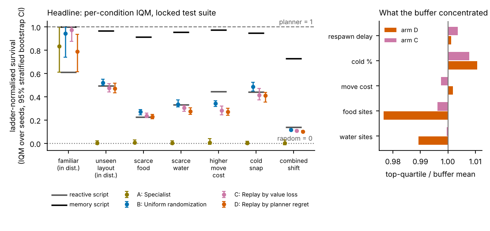

# AdaptArena v2

> **Does training where the policy fails most produce agents that survive unseen shifts better than uniform randomization, at equal compute?**
> A hypothesis, tested in a small survival world where a reference planner makes regret cheap. If it loses, the report says so.



<!-- RESULTS:START -->
## Results

### v2.1 (plan `analysis_plan_v2_1.yaml`; every number below regenerates from `results/full/v2_1/`)

Tier labels: **confirmatory** = pre-declared on the fresh suite; **exploratory** = validation suites or descriptive; **diagnostic** = no claim.

#### Mutation arms (confirmatory at 2M, 10 seeds, fresh suite `suite_test_v2_1.json`)

| Arm | Aggregate ladder-normalised IQM [95% CI] |
| --- | --- |
| B: uniform randomization | 0.393 [0.377, 0.408] |
| D: replay by planner regret | 0.329 [0.314, 0.345] |
| E: regret replay + mutation | 0.303 [0.291, 0.317] |
| E-prime: value-loss replay + mutation (control) | 0.309 [0.292, 0.327] |
| F: regret over 4 rollouts | 0.304 [0.289, 0.320] |

- E vs B (confirmatory): IQM difference -0.090 [-0.110, -0.069], P(improvement) 0.171 [0.111, 0.236]: **not supported (reversed)**.
- E vs E-prime (confirmatory): IQM difference -0.006 [-0.028, 0.016], P(improvement) 0.459 [0.360, 0.559]: **not supported (interval includes zero)**.
- Pre-declared outcome row: **E ties or loses to B: the v2 conclusion stands under a fairer buffer.**
- Headroom rule: Every learned arm stays below 0.5 of the planner-random ladder: the experiment is learner-limited, and the arms cannot be separated at this competence.
- E vs D (exploratory): -0.026 [-0.046, -0.005].
- F vs D (exploratory): -0.025 [-0.047, -0.003].
- F vs B (exploratory): -0.089 [-0.110, -0.067].

#### Budget sweep (exploratory, descriptive; 3 seeds)

| Budget | B IQM | D IQM | D minus B |
| --- | --- | --- | --- |
| 2M | 0.370 [0.353, 0.396] | 0.302 [0.286, 0.318] | -0.068 [-0.097, -0.045] |
| 8M | 0.426 [0.382, 0.467] | 0.430 [0.408, 0.451] | 0.004 [-0.042, 0.053] |

Both arms rise and the D minus B interval includes zero: the v2 gap closes with budget, and regret neither helps nor hurts. (descriptive; with this few seeds no claim is labeled supported.)

The 20M budget points were not run (cut for compute: about 720 steps/s per job after a host change, so one 20M job needs about 7.7 hours). The sweep is reported at 2M and 8M only.

#### Memory diagnostics (diagnostic and exploratory; validation suites)

Imitation ceiling (2000 script episodes, 989110 samples): memory script 0.95; clones ff: 0.20, lstm_w64: 0.18, lstm_w256: 0.14 (mean ladder-normalised score, `suite_val.json`).
DAgger-lite rounds (round 0 to 3): ff: 0.20 -> 0.24 -> 0.36 -> 0.42, lstm_w256: 0.17 -> 0.28 -> 0.27 -> 0.32.
Retuned LSTM (4 seeds at 2M; the plan said 10, cut for compute because each run took about 2.3 hours): 0.121 [0.088, 0.165] against feedforward arm B 0.351 [0.329, 0.372] on `suite_val_s1.json`.

| Prediction | Criterion | Grade |
| --- | --- | --- |
| P1 | LSTM clone at least 0.9 of the script, feedforward clone below 0.6 | **partial** |
| P2 | map-fed feedforward at least 0.8 of the script's score at the full budget and above plain feedforward with an interval excluding zero | **miss** |
| P3 | window 256 beats window 64 with an interval excluding zero | **hit** |

Both clones stay well below the script (best 0.19 and 0.21 of its score for the LSTM and feedforward clone). DAgger rounds lift them only to 0.44 (feedforward) and 0.34 (LSTM), so the shortfall is not just covariate shift. A hand-fed map does not help reinforcement learning (0.46 of the script, difference from plain feedforward -0.012), and the retuned LSTM stays below feedforward (-0.229 on the validation suite not used for selection). This does not separate the three explanations: no route reaches the script, so the data neither show that the architecture cannot hold the memory the task needs, nor that reinforcement learning missed a memory it could have used, nor that memory is unneeded. What it does rule out is a quick fix by a larger backpropagation window (it helps the LSTM a little, which still stays far below feedforward), a hand-fed map, or retuning the learning rate and entropy at these budgets.

#### SSM (rung 8), int8, gamma (exploratory)

SSM (rung 8): **not run**, cut for compute: SSM trained at about 95 steps/s per job on the named 4-core Xeon, so the stop-rule tuning pass alone needs about 4.5 hours. Nothing about the SSM is claimed.
- int8 ppo_ff: retention 0.951 [0.906, 1.001] (float32 0.351 vs int8 0.334), action agreement 0.979, size 1623 kB -> 415 kB.
- int8 ppo_lstm: retention 1.119 [0.949, 1.305] (float32 0.121 vs int8 0.136), action agreement 0.933, size 1702 kB -> 436 kB.
- Gamma re-run with return normalization (5 seeds, 600k steps): gamma 0.9 penalty 0.116 [0.088, 0.148] (v2 unnormalized 0.179 [0.146, 0.211]); rows that fired: penalty shrinks or vanishes.

#### Audit and throughput (diagnostic)

- Selection audit: ablation tables were scored on the suite that chose each checkpoint. Re-scored on `suite_val_s1.json`, the finding changes for 5x5 vision and time-out treated as death. Both ledger rows are kept, with dates.
- Training throughput on Intel(R) Xeon(R) Processor @ 2.80GHz: 1889 steps/s for one job, 7874 steps/s aggregate with 4 parallel jobs. Stop rule (plan 3.4): no change worth more than 1.2x (best measured 1.17x, fast_rollout). No speed-up adopted; fast_rollout stays off by default. Phase 5 runs at the v2 speed.
- Existing arms re-scored on the fresh suite (yardstick, no new claim): A: specialist 0.009 [0.001, 0.018]; B: uniform randomization 0.393 [0.377, 0.408]; C: replay by value loss 0.343 [0.329, 0.358]; D: replay by planner regret 0.329 [0.314, 0.345].

---

### v2 result, as published (full tier: 10 seeds per arm, 2M transitions each, locked test suite of 7 conditions x 50 certified scenarios)

**Planner-regret replay did not beat uniform randomization; it lost.** The pre-declared outcome rule fired as `D_loses_to_B`.

| Arm | Aggregate ladder-normalised IQM [95% CI] |
| --- | --- |
| A: specialist (pooled over all 7 conditions; 0.81 on its own layout, 0.01 on unseen layouts) | 0.010 [0.003, 0.019] |
| B: uniform randomization | 0.387 [0.374, 0.400] |
| C: replay by value loss | 0.337 [0.324, 0.351] |
| D: replay by planner regret | 0.315 [0.299, 0.331] |

- D vs B (pre-declared): IQM difference -0.072 [-0.093, -0.051], P(improvement) 0.193 [0.121, 0.271]: **not supported**.
- D vs C (pre-declared): IQM difference -0.022 [-0.043, -0.001]: **not supported**.
- Why (exploratory diagnosis in the report): every training scenario is planner-solvable (1.00 certified), so regret collapses to the policy's shortfall; ~48% of replay-arm episodes are repeats; scenario parameters explain almost none of what is hard (CV R² 0.02); the score is noisy (rank correlation 0.60 across sampled rollouts).
- Parity gate with Stable-Baselines3 passed: own PPO IQM survival 216.5, SB3 215.6, curves overlap at 100% of points.
- Memory track: 1 of 5 locked predictions hit; the LSTM did not beat the feedforward policy where memory was predicted to help (5 seeds vs 10, hyper-parameters borrowed from the feedforward sweep by a dated amendment).
- Ablations (exploratory, scored on the validation suite that chose each checkpoint; see v2.1 audit below): gamma 0.9, 3x3 vision and removing the previous action hurt; gamma 0.999, 5x5 vision, removing the energy-cost stat, naive reward shaping, potential-based shaping and time-out treated as death had no measurable effect.
- Scripted baselines are strong: the memory script reaches 0.7 to 1.0 of the planner on every condition. The baseline ladder is on the site and in the report.

Limits: one small custom environment; only this benchmark; a stated hypothesis that lost. Nothing here says regret-guided training is worse in general. Hardware numbers are from one named 4-core Xeon.

<!-- RESULTS:END -->

AdaptArena v2 exists (v2.1 adds a second, separately pre-registered round; see the results block) to show that its builder can design an RL environment, implement the learning algorithm, and report results that hold up under scrutiny.
**The report is the product** ([`results/full/report/report.pdf`](results/full/report/report.pdf); also the Report page of the [site](site/published/report.html)); the [overview video](docs/adaptarena_v2_overview.mp4) is captions only; the site, the video and the package exist to get you to it and let you trust it.

## What a reviewer finds

- **An environment with integer state, bit-exact replays and a reference planner** that certifies every scenario solvable (`src/adaptarena/core/`). Energy and hydration are integer hundredths, cost multipliers are integer percents, and the state hash is SHA-256 over a fixed byte layout; a golden hash is checked on Linux, macOS and Windows in CI. The planner's plans are verified by replay and cross-checked against exhaustive search on tiny maps.
- **PPO written from scratch, unit tested and matched against Stable-Baselines3** (`src/adaptarena/lab/ppo.py`, `tests/test_ppo.py`, the parity gate in the report).
- **A baseline ladder from random to planner** (uniform random, reactive script, memory script, human, own PPO, SB3 PPO, PPO+LSTM, reference planner; the small SSM rung was not run), so every number has context.
- **The headline experiment**: four arms (specialist, uniform randomization, replay by value loss, replay by planner regret), 10 training seeds each, IQM with stratified bootstrap CIs, a locked test suite, and an analysis plan that was hashed and committed before that suite existed (`analysis_plan.yaml`, `analysis_plan.sha256`).
- **Probes that show what each policy learned**, each paired with what it does not show; stress curves with Kaplan-Meier survival and breaking points; a red-team search that finds verified failures.
- **A static site** where anyone can play the same fog-of-war game (the Python core runs in the browser through Pyodide) and rank themselves against the agents.

## Install and use

```bash
# not on PyPI yet: install from git
pip install "adaptarena @ git+https://github.com/ARCHITECTURA-AI/adaptarena"          # environment, planner, baselines (NumPy + Gymnasium only)
pip install "adaptarena[lab] @ git+https://github.com/ARCHITECTURA-AI/adaptarena"    # + PyTorch, training code, statistics
```

```python
import gymnasium as gym, adaptarena
env = gym.make("AdaptArena-Survival-v1")
obs, info = env.reset(seed=0)        # obs = {"grid": (8, 9, 9), "stats": (11,)}
obs, reward, terminated, truncated, info = env.step(env.action_space.sample())
```

```python
from adaptarena import ScenarioSpec, build_scenario, plan, verify_plan
sc = build_scenario(ScenarioSpec(layout_id=7, timing_seed=3, n_water=2))
res = plan(sc)                                    # full-information search
print(res.certified, verify_plan(sc, res.actions))  # certificate, replayed in the environment
```

## Reproduce

```bash
make reproduce TIER=smoke   # minutes on a laptop: 1 seed, a few scenarios; runs in CI on every commit
make reproduce TIER=dev     # 3 seeds, 20 scenarios per condition
make reproduce TIER=full    # the published benchmark: 10 seeds, 50 scenarios per condition
```

Every stage is resumable and writes `results/<tier>/` (manifest, episode CSVs, aggregate CSVs, training metrics, replays, checksums). `adaptarena export --tier full` produces the experiment export package; `requirements-lock.txt` pins the software; `releases/` holds the released checkpoints with model cards.
Training reproducibility is stated as same machine and same software; evaluating a fixed checkpoint is bit-exact.

| Command | What it does |
| --- | --- |
| `adaptarena calibrate` | baselines and planner on validation seeds (difficulty calibration) |
| `adaptarena tune` | one small sweep per learned method, validation only |
| `adaptarena parity` | own PPO vs Stable-Baselines3 gate (blocks the headline run) |
| `adaptarena headline` | four arms, locked test suite, statistics, claim ledger |
| `adaptarena ablations` / `memory` | exploratory ablation ladder; locked memory-track predictions |
| `adaptarena stress` / `redteam` / `probes` | stress curves, verified failures, what-it-learned probes |
| `adaptarena v21 <stage>` | one v2.1 stage (`audit`, `suite`, `rescore`, `imitation`, `mapfed`, `lstm-retune`, `lstm-final`, `predictions`, `mutation`, `sweep`, `gamma`, `int8`, ...) or `queue` for all of them in priority order |
| `adaptarena site` / `report` / `export` | static site, technical report, export package |

## Live site

The static showcase is deployed to GitHub Pages from `site/published` by `.github/workflows/pages.yml` (repository Settings > Pages > Source: GitHub Actions). Rebuild it with `make publish` after re-running the experiments.

## Layout

```
src/adaptarena/core/   environment, batch env, planner, baselines, distributions   (NumPy only)
src/adaptarena/lab/    PPO, models (FF/LSTM/SSM), PLR buffer, statistics, probes, stress, red team, site/report builders
site/                  TypeScript + Canvas 2D showcase (builds to site/dist, plain static files)
analysis_plan.yaml     pre-registration; its SHA-256 is committed before the locked suite is generated
configs/tiers.yaml     smoke / dev / full sizes
tests/                 core, PPO, statistics and lab tests
```

Separation rules: the core never imports lab or frontend code; rendering never determines physics; policies consume observations, never the world object; evaluation never changes model weights; training runs headless.

## Claims this project will not make

That the agents developed intelligence or understand survival; that regret-guided training is better in general (only under this benchmark, with its limits stated); that the planner is optimal; that probes reveal reasoning; that domain randomization always improves robustness; that the environment models real ecology or that this is a new RL algorithm; any hardware speed or energy claim for the SSM or quantized policies that was not measured on named hardware.

## Related work (checked and cited, no novelty implied)

Minigrid (Chevalier-Boisvert et al., NeurIPS D&B 2023), Procgen (Cobbe et al., ICML 2020) and Craftax (Matthews et al., ICML 2024) are established benchmarks; Prioritized Level Replay (Jiang et al., ICML 2021), Replay-Guided Adversarial Environment Design (Jiang et al., NeurIPS 2021) and PAIRED (Dennis et al., NeurIPS 2020) are the replay and regret ideas used here. What this repository adds is narrow: a reference planner that gives solvability certificates and exact regret in a small world, bit-exact integer state, controlled interventions with stress curves, and a locked statistical protocol (Agarwal et al., NeurIPS 2021).

Apache-2.0 licensed.
